<div align="center">

# Nivaara — Hotel Booking System

**A full-stack hotel booking platform built with PHP & MySQL.**
Guests search rooms, check live availability, book and pay online, download PDF receipts and leave reviews.
Hotel staff run everything from a dedicated admin dashboard.

[](https://github.com/uttaminsights/HBWebsite/actions/workflows/ci.yml)


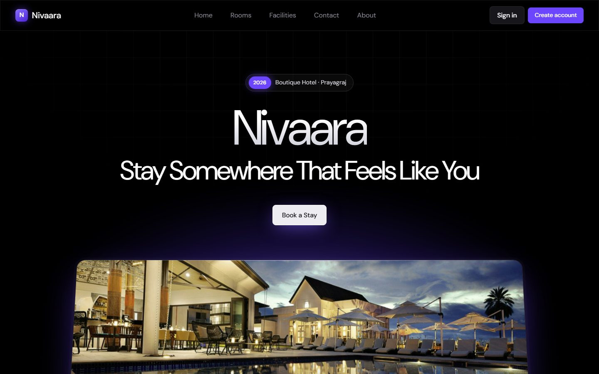

</div>

## Screenshots

### Guest website

| Rooms on the home page | Reviews & stats |
|---|---|
| 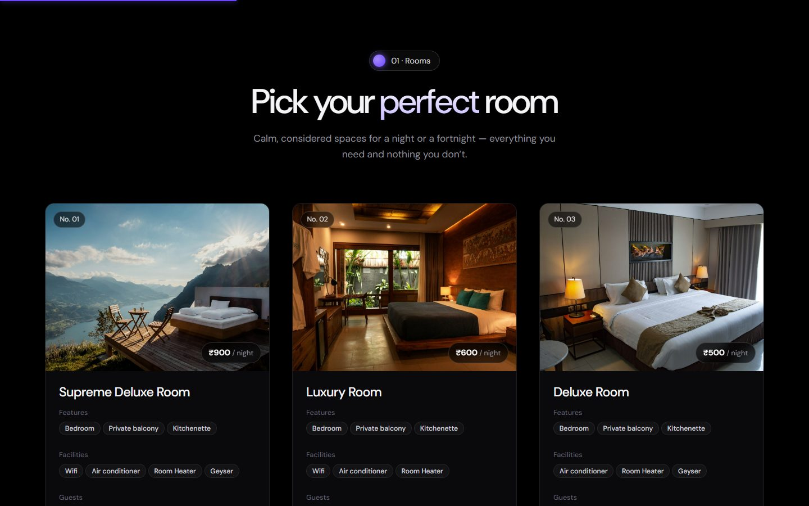 | 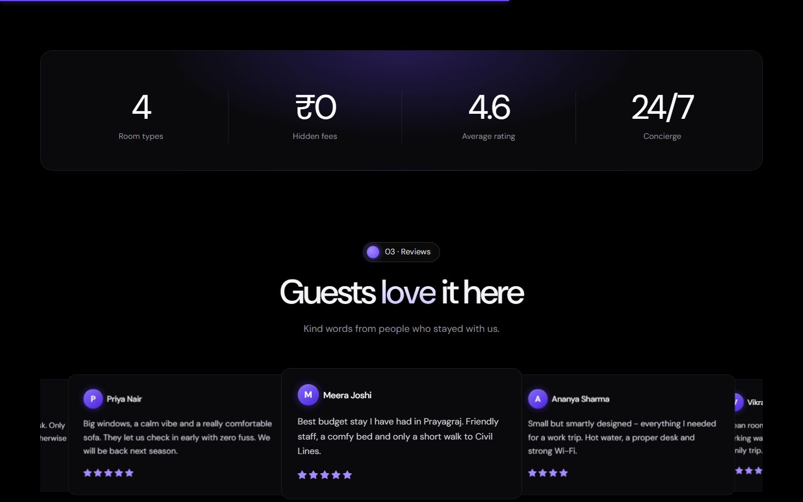 |

| Room search & filters | Room details |
|---|---|
| 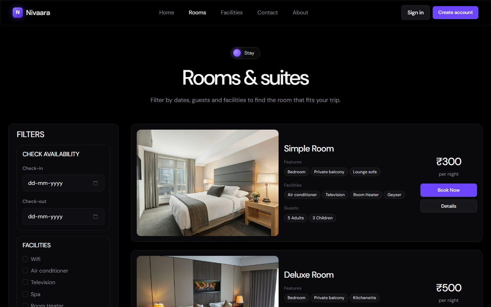 | 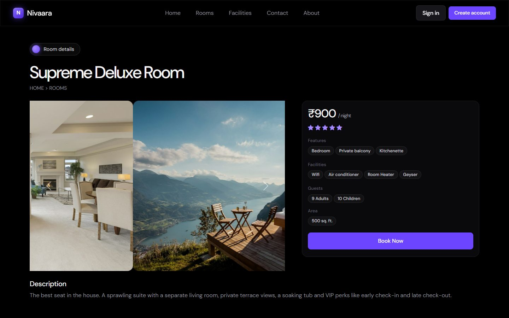 |

| Facilities | Mobile |
|---|---|
| 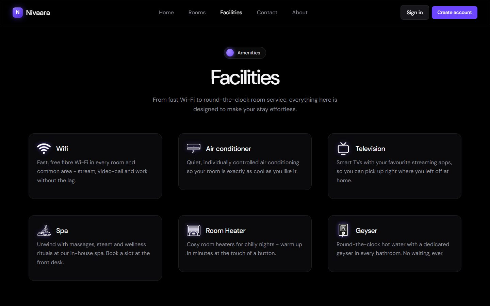 | 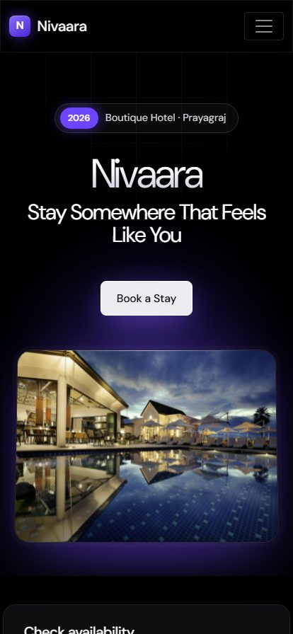 |

### Admin dashboard

| Sign in | Dashboard |
|---|---|
| 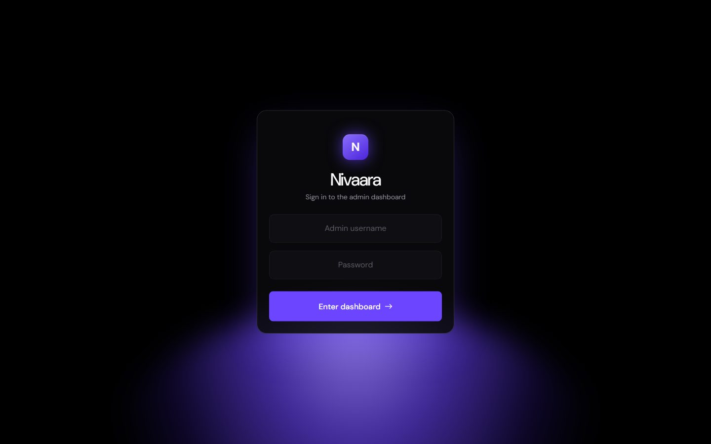 | 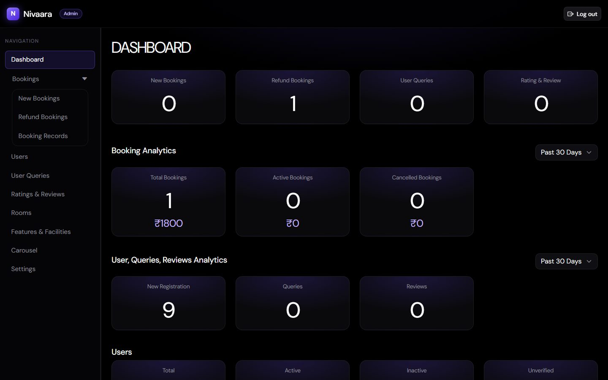 |

| Room management | Ratings & reviews |
|---|---|
| 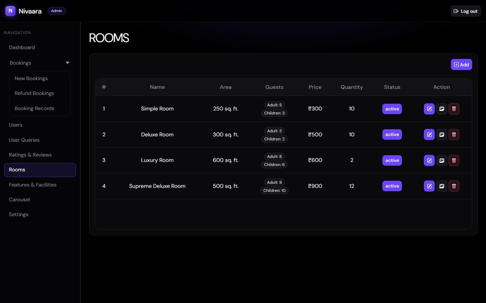 | 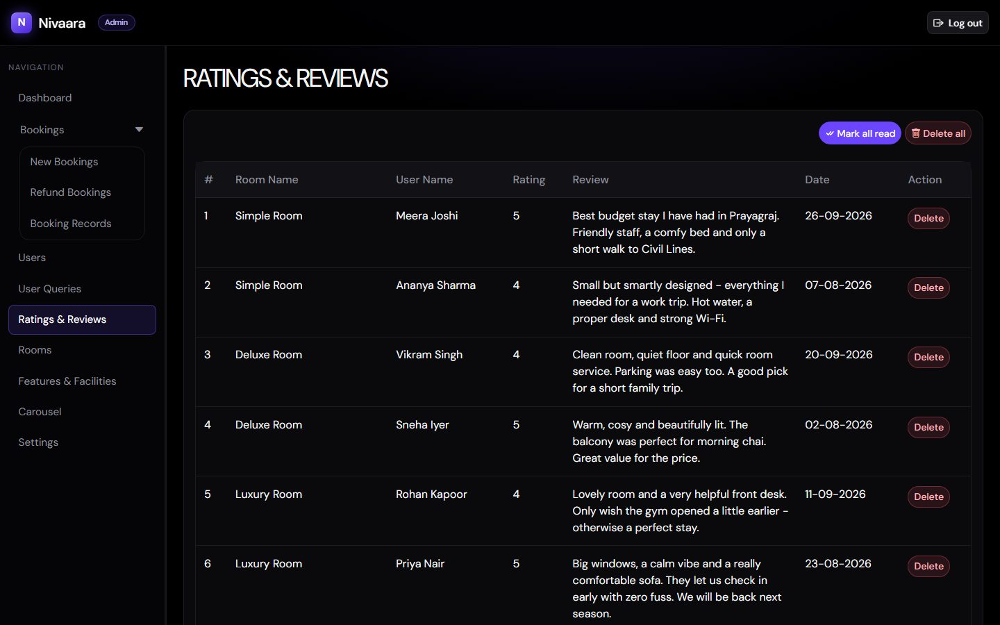 |

## Features

### For guests
- **Room discovery:** filter rooms by dates, number of guests and facilities, with live availability.
- **Booking & payments:** prices are calculated on the server, and payment goes through Paytm. A demo mode lets you test without a payment gateway.
- **Accounts:** register, verify your email (SendGrid), reset your password, and edit your profile and photo.
- **My bookings:** view your stays, cancel, request refunds and download PDF receipts (mPDF).
- **Reviews & ratings:** rate a room after check-out. Reviews show on the home page and the room page.
- **Responsive:** works on desktop, tablet and mobile.

### For hotel staff
- **Dashboard:** live counts of new bookings, refunds, guests, messages and reviews, plus revenue analytics.
- **Booking workflow:** assign room numbers to new bookings, process refunds and search the booking history.
- **Content management:** manage rooms (with photo galleries), features, facilities, the home page slideshow, contact details and team members.
- **Guest management:** view, search, activate or suspend guest accounts.
- **Messages & reviews:** read contact-form messages and moderate reviews.
- **Shutdown mode:** pause new bookings site-wide with one switch.

## Security

- Prepared statements for all database queries.
- Passwords hashed with bcrypt, including the admin password (old plain-text passwords are upgraded automatically).
- Booking prices and dates are rebuilt on the server, so a guest can't change the amount.
- Paytm callbacks are checked three ways: checksum, Paytm's status API and an exact amount match.
- Ownership checks on receipts, cancellations, reviews and profile changes.
- Uploaded files are checked by their content, given new random names and blocked from running as code. Images are re-encoded, and SVGs containing scripts are rejected.
- Session hardening: HttpOnly and SameSite cookies, a new session ID at login, and CSRF tokens on the admin delete links.
- Secrets live in a git-ignored `config.php`, never in the code.

## Tech stack

| Layer | Tools |
|---|---|
| Backend | PHP 8.1+ (no framework), MySQL 8 / MariaDB |
| Frontend | Bootstrap 5, Swiper.js, vanilla JavaScript, DM Sans |
| Integrations | Paytm payment gateway, SendGrid email, mPDF |
| CI | GitHub Actions: syntax check on PHP 8.1–8.3, plus a test import of the database file into MySQL 8 |

## Getting started

### Requirements
- PHP 8.1+ with `mysqli`, `gd`, `mbstring`, `curl`, `openssl` and `fileinfo`
- MySQL 8 or MariaDB 10.4+
- XAMPP/WAMP, or PHP's built-in server

### 1. Get the code
```bash
git clone https://github.com/uttaminsights/HBWebsite.git
cd HBWebsite
```

### 2. Create the database
```bash
mysql -u root -p -e "CREATE DATABASE hbwebsite CHARACTER SET utf8mb4"
mysql -u root -p hbwebsite -e "source DATABASE_FILE/hbwebsite.sql"
```
Or create the database in phpMyAdmin and import `DATABASE_FILE/hbwebsite.sql`.

**Optional demo content.** For a demo or portfolio, also import `DATABASE_FILE/demo_data.sql`:
```bash
mysql -u root -p hbwebsite -e "source DATABASE_FILE/demo_data.sql"
```
It adds 8 fictional guests (`@example.com` emails, they can't log in) with completed stays and reviews, so ratings and review sections have content. **Don't import it on a live site**: invented reviews shown to real customers count as fake reviews.

### 3. Configure
Copy `config.example.php` to `config.php` and fill it in:

| Setting | What it's for |
|---|---|
| `db_*` | Your MySQL login |
| `site_url` | Leave empty locally (detected automatically). Set your HTTPS URL in production. |
| `payment_mode` | `demo` confirms bookings without charging (local testing only). `paytm` uses real checkout. |
| `paytm_*` | Merchant key and MID from the Paytm Business dashboard |
| `sendgrid_*` | API key and sender for verification and password-reset emails. Without it, new accounts are activated straight away. |

`config.php` is git-ignored, so your secrets never get committed.

### 4. Run
```bash
php -d output_buffering=4096 -S localhost:8000
```
Open **http://localhost:8000**. The admin panel is at **/admin/**, with default login `uttaminsights` / `ChangeMe@123`. Change it right away:
```bash
php admin/tools/set_admin_password.php uttaminsights "YourNewPassword"
```
With XAMPP, put the project in `htdocs/<any-folder>` and open `http://localhost/<any-folder>/`.

## Going live checklist
- [ ] Set `site_url` to your HTTPS domain (password-reset and verification links are built from it).
- [ ] Set `debug` to `false`, `payment_mode` to `paytm` and `paytm_environment` to `PROD`.
- [ ] Add SendGrid credentials.
- [ ] Change the admin password.
- [ ] Don't import `demo_data.sql`; if it was imported, remove its rows (instructions are at the top of the file).
- [ ] Make `images/` writable by the web server. On Nginx, also block script execution inside `images/` (Apache uses the included `.htaccess`).

## Project structure

```
├── index.php, rooms.php, room_details.php, ...   Guest pages
├── ajax/                                         Guest AJAX endpoints (auth, booking, profile, reviews)
├── admin/                                        Admin pages
│   ├── ajax/                                     Admin AJAX endpoints
│   ├── inc/                                      DB helpers, shared helpers, config loader, mPDF
│   └── tools/set_admin_password.php              CLI tool to create or reset an admin
├── inc/                                          Header/footer, Paytm and SendGrid libraries
├── css/                                          Site styles
├── images/                                       Uploaded and site images
├── DATABASE_FILE/                                hbwebsite.sql (schema) and demo_data.sql (optional)
├── docs/screenshots/                             README images
└── config.example.php                            Copy to config.php
```

## Credits
- Photography from [Unsplash](https://unsplash.com) (free to use under the Unsplash License).
- [Bootstrap](https://getbootstrap.com), [Bootstrap Icons](https://icons.getbootstrap.com), [Swiper](https://swiperjs.com), [mPDF](https://mpdf.github.io), [SendGrid PHP](https://github.com/sendgrid/sendgrid-php).

---

<div align="center">
Built by <a href="https://github.com/uttaminsights"><b>UttamInsights</b></a>
</div>
